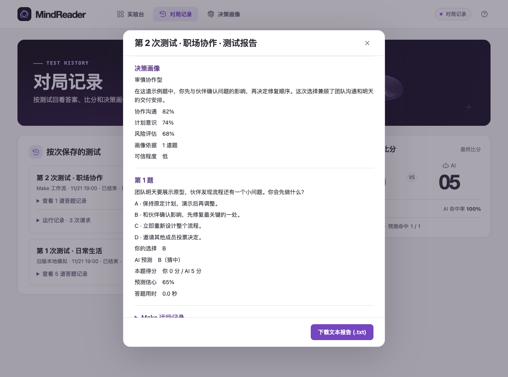

# MindReader 读心实验室

玩家选择情境题的答案，AI 预测玩家会选哪一项。每次提交都返回预测和本题比分，结束时根据本局答案生成决策画像。



## 项目内容

| 目录 | 用途 |
| --- | --- |
| [web](web/) | 网页、同源 Worker API、对局回看和中文报告导出 |
| [make](make/README.md) | 一个统一入口和三个独立场景的蓝图、数据结构样例、Google Sheets 表头 |
| [hoppscotch](hoppscotch/README.md) | 两套可导入的测试集合和本地空环境生成器，出题结果会自动传给答题请求 |

## 在本机打开网页

需要 Node.js 22 或更新版本。项目使用 Node.js 内置模块，在仓库根目录运行以下命令即可构建、验证和打开网页。

```sh
node web/scripts/build.mjs
node web/scripts/validate-artifact.mjs
node web/scripts/serve.mjs
```

打开 [本机实验台](http://127.0.0.1:8787)。验证脚本用模拟响应检查出题、提交、画像和异常回执，无需外部账号。新开一局会实际调用 Make，需要先完成下面的连接设置。

## 连接自己的 Make 和 Sheets

1. 按 [Make 配置说明](make/README.md) 导入统一入口蓝图，创建三个工作表，绑定自己的 Google Sheets 和模型连接。三个独立场景也可分别导入，用配套的 Hoppscotch 集合调用。
2. 将统一入口的私有 Webhook 地址存入服务端环境变量 `MAKE_ENTRY_WEBHOOK`。本机可在仓库根目录新建已被 Git 忽略的 `.env`，写入 `MAKE_ENTRY_WEBHOOK=` 并在等号后粘贴地址。构建后执行 `node --env-file=.env web/scripts/serve.mjs` 即可带配置启动。
3. 从 Make 场景的 **History** 页面复制浏览器地址，填入 `web/dist/index.html` 中名为 `make-history-url` 的 meta 标签并重新构建。此处填写以 `/logs` 结尾的执行历史页面地址。有执行编号的请求会显示直达链接。此项留空时仍可在网页查看记录和编号。
4. 部署到 Sites 时，以 `web/` 为项目目录，在 `.openai/hosting.json` 绑定自己的 Site 项目 ID，在托管平台设置同名服务端 secret，再运行 `node scripts/build.mjs`。Worker 入口是 `dist/server/index.js`。

## 完成一局和导出结果

1. 打开「实验台」选择主题和题数。每次出题调用 `start_game`。
2. 选择 A、B、C 或 D 并提交。`submit_choice` 返回预测和比分，将答题及计分记录分别写入 `answers`、`scores`。AI 猜中得 5 分，否则玩家得 5 分。
3. 答满题数，或至少答一题后提前结束。`generate_profile` 为本局生成画像并写入 `profiles`。每局使用独立的测试用户编号。
4. 在「对局记录」或画像页点「导出报告」，先预览比分、画像和逐题选择，再下载中文 UTF-8 文本。运行记录按局保存在当前浏览器；Make 执行历史可在对应账号查看。
